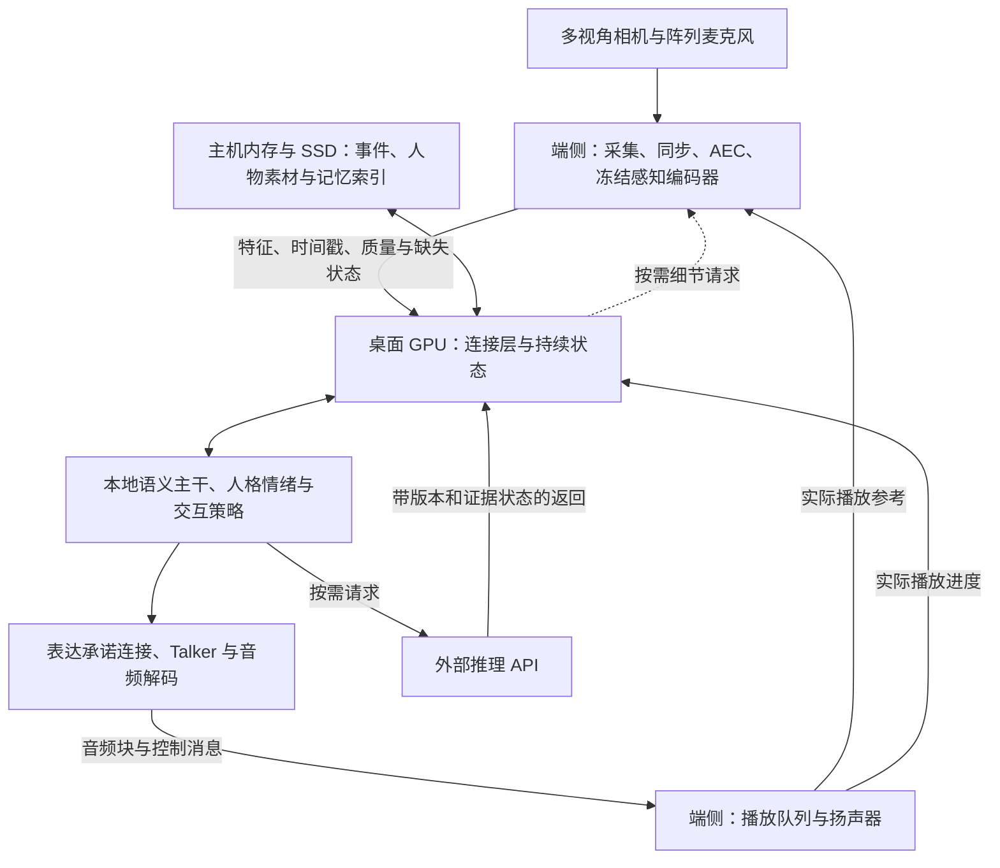

# 端侧感知与桌面计算协同：分布式部署可行性设计

版本：v0.1；资料核验：2026-10-14；整理日期：2026-10-15。性质：探索项目的前期部署设计，依据本轮讨论及已有架构整理；不是已经实现的系统、性能测试报告或采购报价。

关联文档：[5090 架构](01-rtx5090-architecture.md)、[5090 训练](02-rtx5090-training.md)、[PRO6000 架构](03-rtx-pro6000-architecture.md)、[PRO6000 训练](04-rtx-pro6000-training.md)、[集群架构](05-cluster-architecture.md)、[人物、记忆与情绪](07-character-memory-emotion.md)。本文件增加一种部署选择，不替代各档模型选型和人物机制设计。

## 1. 判断与适用范围

**推荐把“端侧冻结感知＋桌面可训练连接层与认知核心”作为正式候选部署方案进行验证。** 合适的模块边界上，中间特征的数据量可以低到普通有线网络能够轻松传输的程度；端侧设备可以常驻一部分权重、承担传感器处理，并减少桌面 GPU 的计算竞争。

需要分别判断三个问题：

| 问题 | 初步结论 | 尚需验证的条件 |
|---|---|---|
| 模块之间能否通过网络连接？ | 可以；本设计中的多组感知特征只需 KB/s 至数 MB/s 量级载荷 | 模型代码是否能导出完整边界状态，时间、位置、mask 与版本是否一致 |
| 能否提高运行效率？ | 有机会降低桌面 GPU 的排队和尾延迟 | 端侧编码耗时、设备间拷贝、封包与网络延迟是否抵消收益 |
| 能否显著降低显存和采购成本？ | 整个模块迁移可以释放其权重与部分运行内存 | 当前轻量感知模块占比较小；不能预期仅迁走它们就腾出几十 GB |

对当前首期配置，更有把握的价值是感知常驻、传感器接入、部署位置灵活和计算干扰减少。避免昂贵服务器是否成立，取决于实际瓶颈是可迁移的外围模块，还是必须快速运行的大型语言主干及其训练状态。

本设计延续以下项目约束：

- 流式多视角、阵列音频和文字输入；保留音色、韵律、环境声音等非文字信息。
- 人格、价值判断、初始经历、后天记忆和情绪共同影响行为；感知变化不直接等于需要向用户描述。
- 输入输出全双工；是否打断、继续、等待、澄清或保持沉默，仍由本地交互策略决定。
- 首期云端模型只在推理时通过 API 调用，不参与训练，也不用于制造首期训练集。返回内容仍需证据与时效判断。
- 可选感知模块缺失或失效时降级运行；桌面认知核心失效后，端侧采集继续工作不等于完整 AI 仍能对话。
- 本期只预留未来传感器与执行器接口，不增加动作控制实现任务。

## 2. 统一内存、显存与模块容量的关系

### 2.1 额外内存需要与计算一起利用

Jetson 的 CPU 与集成 GPU 共享本机 SoC DRAM。这个特性有利于本机数据交换和减少重复分配，但不能通过普通网线自动与另一台计算机的 GPU 显存合并。[NVIDIA CUDA for Tegra 内存说明](https://docs.nvidia.com/cuda/cuda-for-tegra-appnote/index.html)

因此，“RTX 5090 的 32GB 显存＋端侧的 64GB 统一内存”可以分别放置不同模块，但不等于得到一张 96GB 的 5090。端侧统一内存还要供操作系统、CPU、采集缓存、运行框架和 GPU 共同使用，不能全部作为可用模型容量计算。

适合的运行方式是：

1. 某模块的权重常驻端侧。
2. 模块的计算也在端侧完成。
3. 网络只传输出特征、控制信息和必要反馈。

不适合作为首期目标的方式是：把大量权重仅存放在端侧内存中，再让桌面 GPU 每一步通过普通网络反复读取。以 10GbE 的理论线速计算，传输 10GB 数据至少需要约 8 秒，尚未计协议、拷贝和排队；这与传输 KB 级特征是不同的问题。

### 2.2 内存大不等于同等计算速度

以下是用于理解取舍的已核实规格，不是本项目模型的性能测试：

| 设备 | 标称内存/显存容量 | 标称内存带宽 | 在本项目中的含义 |
|---|---:|---:|---|
| Jetson AGX Orin 64GB | 64GB 共享系统内存 | 204.8GB/s | 可以承载端侧模块，但必须验证持续编码速度 |
| Jetson Thor T5000 | 128GB 共享系统内存 | 273GB/s | 容量更大，可研究较大的独立模块；不能仅按容量判断实时能力 |
| RTX PRO6000 Blackwell Workstation | 96GB 显存 | 1792GB/s | 适合常驻桌面认知与生成模块；这里明确为 Workstation 版 |

来源：[Orin 官方规格](https://www.nvidia.com/en-us/autonomous-machines/embedded-systems/jetson-orin/)、[Thor 官方规格](https://developer.nvidia.com/blog/introducing-nvidia-jetson-thor-the-ultimate-platform-for-physical-ai/)、[PRO6000 Workstation 数据表](https://www.nvidia.com/content/dam/en-zz/Solutions/data-center/rtx-pro-6000-blackwell-workstation-edition/workstation-blackwell-rtx-pro-6000-workstation-edition-nvidia-us-3519208-web.pdf)。

实际模型速度还受计算量、算子实现、量化方式、批量、功耗与散热影响，不能把内存带宽比例直接当作速度比例。同属 NVIDIA 平台也需要分别验证 Arm 环境、驱动、运行框架和自定义算子的兼容性。

## 3. 推荐的初始部署架构



### 3.1 各部分放置建议

| 部分 | 首期位置 | 理由与边界 |
|---|---|---|
| 相机、阵列采集、时间记录、环形缓存 | 端侧 CPU/专用采集硬件 | 靠近传感器；同一阵列尽量采用同步采样 |
| 回声消除、播放参考、阵列前处理 | 端侧 | 能直接获得实际播放音频与采集信号 |
| 冻结视觉与环境声编码器 | 优先尝试端侧 | 模块边界相对清晰；低频更新适合异步执行 |
| 冻结语音语义编码器 | 根据实测决定 | 端侧能跟上窗口更新才迁移；否则端侧处理波形后上传 |
| CAM++ 等说话人编码器 | 可放端侧 | 向量很小；窗口积累和重叠说话问题仍然存在 |
| 可训练投影、重采样、融合连接 | 桌面 GPU | 首期集中训练与调试，避免引入跨设备反向传播 |
| 持续状态、人格情绪、交流与证据头 | 桌面 GPU，与语义主干同机 | 模块相对小但交互频繁；保持状态与版本协调 |
| 语义主干、表达承诺连接、Talker/解码器 | 桌面 GPU | 首期保留完整生成链，降低流式状态协调复杂度 |
| 音频播放与缓冲 | 端侧 | 将实际已播进度反馈给认知和 AEC |
| 长期记忆、素材、索引 | 首期主机内存与 SSD；以后可独立服务 | 只将当前检索结果送入 GPU，容量增长不要求显存同比增长 |
| 复杂推理 API | 外部异步服务 | 保持此前云端仅推理、由本地控制表达的边界 |

端侧不必承担所有感知模型。更稳妥的推进顺序是先迁移采集与播放，再迁移视觉和环境声，最后依据延迟测试决定语音语义是否迁移。

### 3.2 网络切分不要求退化为文字接口

接口应当能够传连续神经特征，而不只是 ASR 文字或“看到了什么”的描述。至少保留以下信息中当前任务需要的部分：

- 视觉 patch/重采样 token、相机 ID、图像有效区域和必要的位置或切片信息。
- 语音语义特征、韵律或快速声学特征、说话人候选、方位与回声残留状态。
- 环境事件特征、质量、有效时间范围和缺失状态。
- 原始片段出处，以便在需要细节时请求补充观察。

网络透明传递边界张量，可以保留模块间的神经连接；是否能够联合优化，还要看反向传播、离散操作、检索与 API 边界。不能仅因分布式接口接受音频并输出音频，就宣称整条系统已经完全可微。

## 4. 传输量估算与接口选择

### 4.1 计算口径

本节使用 FP16，每个元素 2 字节；KB、MB、GB 为十进制字节单位，Mb/Gb 为比特单位；GiB 用于后文二进制显存估算。

\[
R_{\mathrm{bytes/s}}=N_{\mathrm{tokens/update}}\times d\times b\times f
\]

其中，\(d\) 是特征维度，\(b\) 是每元素字节数，\(f\) 是每秒更新次数；多路输入再乘实际路数。所有下表值均为算术载荷，不是实际链路吞吐或已达到性能。

| 候选传输内容 | 张量/采样假设 | 载荷 | 等价比特率 |
|---|---|---:|---:|
| 5090 视觉编码器输出 | 每帧 64×768；2 视角，各 2fps | 393.216KB/s | 3.146Mb/s |
| 同一路视觉经新重采样器压缩 | 每帧 8×512；2 视角，各 2fps | 32.768KB/s | 0.262Mb/s |
| 5090 语音连接层输出 | 16×512；每 320ms 更新 | 51.200KB/s | 0.410Mb/s |
| 说话人原始 embedding | 192 维；每 500ms 更新 | 0.768KB/s | 0.006Mb/s |
| PRO6000 视觉原配重采样输出 | 每图像单元 64×4096；2 视角，各 1fps；每帧 1 个单元 | 1.049MB/s | 8.389Mb/s |
| 上一路扩大视角与频率 | 4 视角，各 2fps；每帧 1 个单元 | 4.194MB/s | 33.554Mb/s |
| 阵列原始音频，对照项 | 8 通道、16kHz、16bit PCM | 256KB/s | 2.048Mb/s |
| 返回播放的波形 | 单声道、24kHz、16bit PCM | 48KB/s | 0.384Mb/s |

尺寸依据：[5090 输入和连接层设计](01-rtx5090-architecture.md)、[PRO6000 原配维度与多视角设计](03-rtx-pro6000-architecture.md)。视觉前两行是替代切分位置，不需要同时上传。语音 16×512 指新增连接后的候选张量，并非宣称冻结语音编码器原生就输出这一尺寸。

MiniCPM 高分辨率处理可能产生多个图像单元，必须乘上实际单元数；不能只按每帧 64 token 给所有分辨率承诺带宽。冻结编码器输出的实际时间长度、额外 mask 和流式状态也需要实现时核验。

### 4.2 不必为了网络先追求极端压缩

千兆以太网的理论线速为 125MB/s，2.5GbE 为 312.5MB/s，10GbE 为 1250MB/s；有效应用吞吐低于这些值，受协议、设备、拷贝和并发负载影响。

一个 64×768 FP16 视觉特征包为 98,304 字节，仅按千兆链路线速计算，串行发送约需 0.79ms。这不是端到端延迟，尚未包含编码、GPU/CPU 拷贝、封包、排队和接收处理，但足以说明这类载荷通常无需先做极限压缩。

**首期推荐在冻结编码器输出处切分，传完整 patch 特征，让可训练重采样器留在桌面。** 待模型行为验证后，再比较减少 token 数和迁移重采样器的收益。

还需避免两种误判：

1. 神经特征不必然比原始信号小。16kHz、单声道、16bit PCM 只有 32KB/s，低于表中的 51.2KB/s 语音连接输出。语音编码放端侧可能节约计算，但未必节约带宽。
2. 降低帧率和压缩特征是两件事。当前视觉估算针对低频对话语义观察；快速动作、唇动、短暂异常需要较高频路径或专门事件检测，不能据此宣称完整高帧率场景无损传输。

### 4.3 硬件接口的初步选择

| 接口 | 首期判断 | 使用条件 |
|---|---|---|
| 有线 1GbE | 足以启动当前小规模实验 | 测量实际吞吐与尾延迟；实时流和大文件传输避免相互阻塞 |
| 有线 2.5GbE | 有现成端口时可优先使用 | 给多路特征与按需原始片段留余量 |
| 有线 10GbE | 多端侧、大量切片或原始数据回传时再考虑 | 不能仅因模型参数大，就认定连接必须万兆 |
| USB 3 / USB4 / 雷电 | 可作为后续候选 | 双方硬件与系统须支持设备模式或主机间通信方式；标称接口速率不等于应用吞吐 |
| PCIe Endpoint 等直接互连 | 特定硬件集成阶段研究 | 需要验证拓扑、角色、驱动与数据交换；首期收益不足以默认承担这部分复杂度 |
| 无线网络 | 后续移动场景研究 | 单独测量抖动、拥塞、断连与播放影响，不把有线结果直接外推 |

初始实现可采用二进制特征载荷与小型结构化元数据，数据流和控制流分别设有界队列。无需为了当前载荷预先要求 RDMA 或特殊共享内存硬件。

## 5. 时间、全双工与故障的接口契约

### 5.1 特征记录需要包含的内容

边界接口不只是一个浮点数组。除张量外，至少需要：会话、人物和模型版本；传感器来源；序号；观测起止时间；编码完成、到达与可用时间；形状、dtype、mask；质量与有效性；对应原始片段 ID。

下例为**接收端已完成时间映射与载荷验证后的记录**，不是要求端侧预知未来网络到达时间。时间均已映射到同一会话单调时钟。

```json
{
  "schema_version": "edge-observation-0.1",
  "session_id": "s001",
  "persona_id": "role_A",
  "persona_version": "1",
  "source_id": "camera_0",
  "sequence_id": 42,
  "observation_id": "camera_0-42",
  "kind": "vision_patch_features",
  "event_start_ms": 4200,
  "event_end_ms": 4200,
  "encoder_finished_ms": 4240,
  "received_at_ms": 4245,
  "available_at_ms": 4247,
  "clock_mapping_version": "sync-3",
  "clock_error_bound_ms": 2,
  "encoder_revision": "locked-checkpoint-revision",
  "preprocess_revision": "resize-normalize-v1",
  "validity": "valid",
  "quality": 0.9,
  "quality_kind": "capture_quality_score",
  "feature_shape": [64, 768],
  "dtype": "float16",
  "byte_order": "little",
  "payload_nbytes": 98304,
  "payload_id": "payload-camera_0-42",
  "source_ids": ["frame-camera_0-42"]
}
```

`payload_id` 指向二进制帧或缓存，实际张量不展开成 JSON 浮点列表。若后续使用量化，还要记录量化格式、scale/zero-point 等实际需要的参数，并进行质量对照。

`quality` 表示明确来源的采集质量估计，不是模型结论正确率。`validity` 沿用公共层的 `valid/missing/stale/corrupt`，详细故障原因另记；正常静音不是 missing。

跨设备时钟不能直接比较各自的本地时间戳。需要保存时钟映射和误差估计；接收端决定信息何时真正可用。训练回放也必须遵守 `available_at_ms <= 决策时刻`，避免模型使用尚未到达的数据。

视觉 native 路径可能还需切片布局、位置、token mask 等信息。只有确认接收端能够依据约定重建这些信息，才可只发送特征与简化元数据。

### 5.2 快速信号与语义特征分开更新

声学活动、能量、回声残留、方向变化和播放状态可沿快速侧路更新；不必等待较慢的语义窗口。其具体周期沿用对应硬件档的设计起点，例如 5090 快侧路每 80ms 更新，但是否能达到该调度周期仍需实测。

快速侧路负责提供此时可得的线索，不能凭空提前理解尚未获得的语义，也不能把“检测到声音就停止播放”当作已经实现模型自主打断。缺少语义信息时，策略应记录自己的信息边界。

SenseVoice 等窗口模型迁到端侧后，原有等待窗口和窗口重算成本仍然存在；网络连接不会把非因果窗口编码器变成原生增量编码器。

### 5.3 播放与 AEC

桌面将音频块发送到端侧时，分别记录 `generated`、`queued`、`played`。只有实际播放的片段才计入“已经向用户说过”的内容。

每个播放块绑定 `session_id`、`persona_version`、`utterance_id` 和序号；停止或替换指令必须能够作废尚未播放的旧片段。端侧定期回传实际播放游标，AEC 使用实际播放参考，而非桌面尚未播出的生成缓冲。

播放缓冲越长，抗抖动能力越强，但可感知的停止也可能越迟。缓冲长度应由实测网络抖动、音频连续性与中止目标共同决定，不能仅为了不断音而无限预缓冲。

人物切换时同时清理或作废旧人物的播放队列、旧状态和异步请求，避免旧音色或旧云端返回混入新人物会话。

### 5.4 降级规则

| 情况 | 处理方式 |
|---|---|
| 某路视觉迟到 | 标记年龄；过期帧可丢弃，保留其他模态工作 |
| 音频缺片或序列中断 | 显式标记缺口，按编码器能力重置相应缓存；不把缺口伪装成真实静音 |
| 端侧编码持续积压 | 调低可降级模态的采样频率、切换较轻路径或回退桌面编码；队列保持有界 |
| 端侧设备离线 | 输入对应 missing 状态；对话按其余可用模态继续 |
| 网络恢复 | 通过会话和版本握手恢复，避免把旧缓冲重放成当前输入 |
| 桌面核心不可用 | 端侧可继续采集或缓存，并按故障策略停止过期输出；不宣称完整认知仍在工作 |
| 云端请求不可用或迟到 | 延续本地证据/等待策略，不把超时转换成事实已确认 |

同一麦克风阵列的各通道优先在同一同步采集设备内处理。若分散到不同设备，采样时钟、漂移和空间标定需作为另一个专项问题验证。

## 6. 实时效率与显存收益

### 6.1 延迟必须按整条路径比较

在保持感知窗口和后续任务相同的条件下，迁移是否改善关键路径，可比较：

\[
T_{edge\ encode}+T_{copy/pack}+T_{network}+T_{receive}
\quad\text{与}\quad
T_{desktop\ encode}+T_{desktop\ contention}
\]

端侧编码可能较慢，但可以减少桌面上的竞争，使语义生成和声音输出更稳定。反之，慢编码器会造成积压；多设备提高系统吞吐，也可能增加单次响应延迟。

模型权重应预加载常驻，避免每个消息重新初始化模型。将大文件上传、日志落盘、后台记忆整理与实时特征/控制消息分开调度。首期先测 CPU 中转和常规网络实现；只有测到拷贝成为瓶颈时，再评估更复杂的传输机制。

### 6.2 当前预算不支持“仅迁走感知就释放几十 GB”的预期

| 原有方案 | 已有规划预算 | 本次可推导的结论 |
|---|---|---|
| 5090 B1 | 感知编码器、CAM++、Talker、Mimi 的权重合计约 1.5–2.3GiB | 只迁走感知子集释放的权重小于这一合计；不能把全部语音输出权重也算作已迁移 |
| 5090 B1 | 推理总预算约 14–22GiB，稳态峰值初始目标不超过 24GiB | 这是原方案规划，需先验证；分布式收益还可能来自激活/工作区与竞争减少 |
| PRO6000 | 推理总预算约 31–52GiB，显存标称 96GB | 当前配置不必因感知权重而默认采购额外大内存设备 |

来源为对应[5090 显存规划](01-rtx5090-architecture.md)和[PRO6000 显存规划](03-rtx-pro6000-architecture.md)，均未实测。量化格式、实现、图像切片、上下文、激活和分配器会改变结果。

迁移收益应分别报告权重、运行中已分配内存、框架预留内存与进程/设备总占用，避免把缓存保留量误算成模型真实需求。迁移后接收端仍要保留接入特征与必要缓存，不会释放原模块涉及的所有字节。

### 6.3 大统一内存更适合承载哪些新增任务

如果希望充分使用端侧较大的内存，可以研究完整、相对独立且容忍较慢响应的模块：后台记忆整理、较慢的视频事件分析、按需细节理解，或未来独立的本地深度推理后端。

这些模块输出事件、记忆候选或带依据的推理结果，由桌面核心决定如何使用。不能让后台模块直接改写人物经历或抢占实时语音输出。现阶段云端推理 API 路线仍保持不变，不因存在这条研究分支而默认新增本地大型推理模型。

## 7. 更深层的模型切分：可行性与代价

### 7.1 语言主干按连续层段切分

把同一个语言主干的不同连续层段常驻两台设备，可以在容量上运行单台设备无法完整容纳的主干。这里传的是层间激活，不是每步重新传全部权重，因此不能笼统认定普通网络一定不够用。

例如，一个 4096 维 FP16 token 激活为 8192 字节。在某个层段边界，单步解码的载荷可以很小；但 4096 token 的预填充激活就约为 33.55MB，且还可能需要位置和缓存等协调信息。该例是尺寸说明，不代表任何模型已完成跨机适配。

单人自回归对话的主要困难是串行依赖：一个 token 需要经过各层段，之后才能推进后续生成。慢设备负责的计算与必要网络往返会进入每一步关键路径；流水线对多请求吞吐的帮助，不能直接当作单会话延迟收益。

若开展这一实验，应先选择少量连续层段边界，避免同一 token 在设备之间逐层来回传递。频繁集合通信的张量并行应另行评估，不能照搬具备高速互联的集群配置。

### 7.2 语义主干与语音生成之间切分

语义条件或音频 token 的载荷可能很小，因此整个语音生成模块可以作为后续候选迁移单元。但要把它需要的 tokenizer、音色参考、条件投影、流式缓存和码本版本作为一套接口处理。

MiniMind/Mimi、MiniCPM/S3 与其他声学体系不能互换 token。也不能仅因张量维度相同，就认为异源 Thinker–Talker 已经语义对齐。首期保留完整桌面生成链，待中止、播放反馈与人物切换通过后，再比较迁移整个声学模块的收益。

### 7.3 持续状态与人格模块暂不单独迁移

这些模块对行为非常重要，但通常不是当前模型的主要内存来源。主干生成时频繁读取状态，拆到另一台设备会增加版本和同步复杂度，容量收益有限。首期与认知核心同机；可在网络上传输必要的只读状态摘要，但不默认建立两份独立更新的“人格真值”。

## 8. 与训练路线和探索目标的衔接

### 8.1 冻结编码器阶段

初始路径为：

\[
x \xrightarrow{E_{frozen},\ edge} z
\xrightarrow{network} z'
\xrightarrow{P_\theta,\ desktop} h
\xrightarrow{F,\ desktop} y
\]

首轮令 \(z'\) 为 \(z\) 的按约定 dtype 传输结果，不先加入额外有损压缩。训练投影/重采样 \(P_\theta\) 与本地新增机制；冻结的前置编码器无需接收梯度。

如果下游 \(F\) 虽然冻结权重，但需要将任务损失传回 \(P_\theta\)，仍必须保留对其输入的梯度。不能把整段下游冻结主干都放入禁止梯度的路径。

固定预处理、编码器和窗口版本后，可预计算或缓存特征。缓存需保留事件时间、原始出处、有效长度和可用时间；不能用完整未来片段生成特征，再伪装成实时窗口输入。增强策略改变输入时也应相应重算或记录。

### 8.2 压缩与部署优化阶段

按以下顺序推进：

1. 验证跨设备传输与同机计算的输出和行为一致性。
2. 验证完整冻结特征能否支持人物、记忆、情绪和全双工目标。
3. 对照不同 token 数、采样频率和必要的量化格式，测量任务质量与传输量。
4. 将已经训练并验证的重采样器移到端侧，锁定连接版本。
5. 研究按当前任务与关注点分配观察预算，以及按需补传细节。

压缩评估不能只看平均重构误差，还要看说话人区分、韵律、短暂事件、人物表达和重要记忆是否受损。即使带宽充足，减少送入主干的 token 仍可能降低主干的上下文与计算负担；这项收益应与网络收益分别报告。

### 8.3 后续解冻与联合训练

当需要训练端侧编码器时，跨设备反向传播在技术上可以成立，但端侧要保存相应激活、接收梯度，并协调版本与优化步骤；它的训练内存与运行时间可能成为新的瓶颈。

训练拓扑与日常推理拓扑可以不同。可以在具备合适资源的训练设备上完成更新，再导出端侧模块；也可以开展分阶段训练。分布式推理成功不等于已经解决大型模型全参数训练的资源问题。

### 8.4 值得保留的研究分支

本项目可以进一步研究“认知状态如何反过来选择观察”，而不只是把现成模块搬到不同设备：

- 平时发送足够维持场景与对话的特征；出现异常或当前任务需要细节时，提高局部采样或请求原始片段。
- 根据记忆、人物关注点和正在讨论的问题，选择需要保留的感知信息。
- 将情绪、身份、环境事件和空间线索纳入压缩质量监督，避免只优化文字内容。
- 学习在带宽、计算、时效和行为质量之间分配预算。

这些机制是后续待训练和消融的研究内容，不能在第一版部署中宣称已经具备。注意力选择也应保留必要的异常检测路径，防止过度筛选而完全遗漏重要事件。

## 9. 成本控制与硬件选择原则

| 使用场景 | 初步判断 | 采购前需要的证据 |
|---|---|---|
| 已有 Jetson 或其他可用端侧设备 | 很适合开始验证 | 编码模型能够运行且不积压；网络与播放可满足需求 |
| 新购设备用于传感器接入、常驻感知或远离主机部署 | 有明确功能价值 | 目标模型在具体设备上的持续处理能力和整机功耗 |
| 仅为当前轻量感知模块释放少量显存，新购高价 64/128GB 设备 | 容量收益可能不足 | 先对照 CPU 卸载、已有设备、本机其他计算资源的总成本 |
| 需要承载较大的独立后台模块 | 大统一内存可能有价值 | 该模块的真实内存占用，以及能否容忍较慢完成 |
| PRO6000 已有足够推理余量 | 不必仅为节省感知权重再购买设备 | 除显存以外，是否确有部署位置、持续感知或调度收益 |
| 希望替代大型全参数训练服务器 | 不能由本方案直接推出 | 另行估算梯度、优化器状态、激活、通信和训练时长 |

成本应包括端侧整机、存储、网络适配器/交换设备、供电散热、长期电耗和部署维护时间。两台设备并行工作不保证总功耗更低；需要实测常驻、交互与空闲三种状态。

本文件没有进行实时采购询价，因此不提供未经核实的设备成交价或回本周期。硬件候选先按可运行的算子、模型延迟、内存余量和接口筛选，再用实际报价比较。只为迁移小型感知模块时，不应首先按最大统一内存容量选购。

## 10. 第一轮验证与决策流程

### 10.1 实验配置

保持同一人物包、模型版本、输入轨迹、感知窗口、上下文预算与输出策略，依次比较：

| 配置 | 部署差别 | 要回答的问题 |
|---|---|---|
| A：同机对照 | 所有模型在桌面；采集/播放位置保持可比 | 当前系统真实的显存与延迟瓶颈在哪里？ |
| B：冻结视觉/环境声迁移 | 端侧编码，桌面保留可训练连接层 | 是否减少桌面竞争？端侧是否跟得上？ |
| C：继续迁移语音编码 | 在 B 基础上迁移语音语义/说话人模块 | 端侧语音速度是否足以抵消拷贝和网络成本？ |
| D：迁移已训练重采样器 | 连接已验证后才做 | 压缩、端侧计算和主干负担的净收益是多少？ |

若 A 使用远端采集而模型同机运行，可上传波形/图像建立同一传感器位置的对照。另用离线回放分离传输差异与现场输入变化，避免把不同输入造成的质量差别算成部署差别。

### 10.2 指标与记录

| 维度 | 至少记录的指标 | 解释要求 |
|---|---|---|
| 内存 | 桌面与端侧稳态/峰值、已分配/预留、设备总占用 | 明确权重、激活、工作区与缓存口径 |
| 特征可用性 | 采集→编码完成→接收→模型可用的 P50/P95 | 不能只报告网络 ping 或吞吐 |
| 实时输出 | 可用信息到首个有效语音、音频断续、播放积压 | 固定输出长度和任务，避免空泛短反馈替代有效回应 |
| 自主打断 | 从信息已足以判断中止到实际停止的延迟、误停/漏停 | 区分“检测到声音”与“具备语义依据” |
| 持续运行 | 队列长度、丢弃/缺口、温度功耗与编码耗时变化 | 首轮至少安排一段约 30 分钟的连续运行；这是测试建议，非已经通过 |
| 行为质量 | 说话人、情绪/韵律、短暂事件、人物表达、重要记忆写入 | 不能只用平均识别准确率代表整个人格系统 |
| 故障恢复 | 迟到、断连、模块重启、人物切换 | 检查旧数据/旧音频是否混入新状态 |

传输层先检查载荷字节与元数据一致性；异构精度、算子或量化带来的编码差异，再单独做数值和任务质量验证。不得把传输错误与模型后端数值差异混为一类。

对网络延迟、抖动、短时断连和模块缺失做可控注入，将这些状态加入后续训练和评估。所有失效实验都使用当时可得信息，不泄露未来恢复时刻或云端完成时刻。

### 10.3 继续、调整与回退条件

- **继续采用：**实时质量达到对应模型实验目标，端侧无持续积压，并且显存、尾延迟、部署位置或总成本至少有一项明确收益。
- **部分采用：**视觉/环境声迁移有效，但语音变慢，则保留前两者，语音回到桌面；不要求所有感知统一放到一个设备。
- **调整压缩：**细节、情绪或身份指标退化，则增加 token/采样预算或保留独立线索，不能仅用平均带宽达标宣布成功。
- **回退部署：**通信和端侧计算导致质量或实时性不可接受，且没有足够资源收益，则保留模块接口设计，继续使用同机运行。

验收阈值应在实验前根据原配基线、对应硬件档目标和人工评估能力确定。本文件不把规划周期、理论带宽或估算显存写成已经达到的结果。

## 11. 初始采用建议与后续维护

第一轮采用“有线 1/2.5GbE＋端侧采集/播放＋可逐项迁移的冻结感知编码器＋桌面连接层、持续状态、人格情绪、主干和语音生成”。长期记忆优先使用主机内存与 SSD。先传充分的特征，再依据质量和资源测试决定是否压缩及扩大迁移范围。

本次仅整理讨论形成文档，没有下载模型、实现网络接口、远程操作端侧设备、运行模型或进行性能测试。后续修订至少记录所用硬件、模型与接口版本、实际测量、行为退化、成本依据和替代决策；对主干分层、语音模块迁移和任务驱动感知预算分别维护实验分支。
