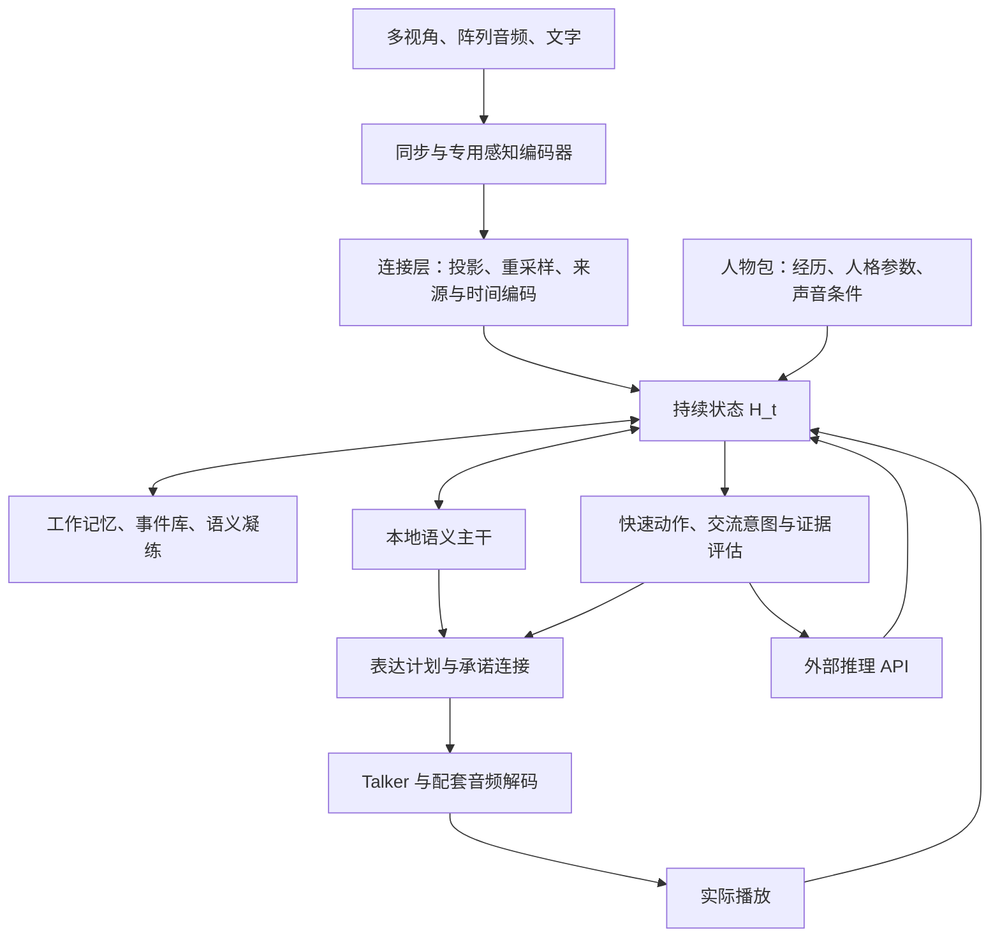

# Encephalon 前期总体设计文档

版本：0.1；资料核验：2026-10-13 至 2026-10-14；整理日期：2026-10-15。

这是一组供探索性项目实施、实验和修订使用的初始设计，不是已经实现的系统。本文档集只新增设计资料，没有下载模型或数据、编写模型实现、执行训练、开展硬件性能测试。公开资料核验不等于模型质量或实时性能验证。

## 1. 文档导航

| 硬件/专题 | 架构设计 | 数据与训练设计 |
|---|---|---|
| 单卡 RTX 5090 32GB | [01：架构、选型、接口和预算](01-rtx5090-architecture.md) | [02：训练阶段、数据格式、公开数据、自建数据和损失](02-rtx5090-training.md) |
| 单卡 RTX PRO 6000 Blackwell Workstation 96GB | [03：架构、选型、接口和预算](03-rtx-pro6000-architecture.md) | [04：训练阶段、数据格式、公开数据、自建数据和损失](04-rtx-pro6000-training.md) |
| 大型服务器集群；参考 8 节点×8 H200 SXM | [05：架构、资源池、选型和接口](05-cluster-architecture.md) | [06：训练切分、数据格式、公开数据、自建数据和损失](06-cluster-training.md) |
| 三档共用的人物设计 | [07：人格、初始经历、后天记忆、动态情绪、人物更换](07-character-memory-emotion.md) | 同一文档包含人物数据 schema、训练目标、阶段和验收 |
| 端侧与桌面协同部署 | [08：模块拆分、网络载荷、实时性、显存与成本](08-edge-desktop-distributed-deployment.md) | 同一文档包含训练衔接、接口契约和对照验证流程 |

建议先读本索引和 07，再阅读拟采用硬件对应的一对文档。三档是不同资源预算下的实验配置，不要求按顺序购买硬件或依次完成所有档位。

独立审阅者可先阅读[项目介绍与方案审阅交接说明](../review/REVIEW_BRIEF.md)，了解研究目标、当前证据状态、文件职责、审阅重点与建议反馈格式。该说明是审阅入口，不是已完成的审阅报告。

## 2. 三档的明确选型与区别

| 事项 | RTX 5090 | RTX PRO 6000 | 集群参考配置 |
|---|---|---|---|
| 官方显存规格 | 32GB GDDR7 | 96GB GDDR7 ECC；明确为 Blackwell Workstation 版 | H200 SXM 每卡 141GB HBM3e；64 卡不是一块连续显存 |
| 原配冻结基线 | MiniMind-O 稠密版及原配 Thinker–Talker | MiniCPM-o 4.5 原配多模态/全双工路径 | Qwen3-Omni-30B-A3B-Instruct 原配路径 |
| 本档主要研究路径 | 先小模型证明机制，再验证 Qwen3-1.7B 与原配声学模块的异源连接 | 保留约 9B 模型已有流式能力，增加持续状态、人物与控制侧路 | 增加持续状态/人物/承诺侧路；指定音色进阶路径采用经过神经桥适配的 CosyVoice3 |
| 新持续状态默认值 | 64×512 | 64×1024 | 256×1024 |
| 流式边界 | 部分冻结感知模块为有界窗口重算，不能等同原生连续流式 | 原生约 1 秒语义块；200ms 快侧路只使用此时已可得信息 | 原配流式输出不等于语义全双工；100ms 状态与更慢感知更新分开 |
| 声学路径 | Mimi 8 码本、12.5Hz、24kHz；换语义主干需重训桥 | 原配 MiniCPMTTS/S3；不能套用 Mimi 码本 | 原配 Qwen Talker作基线；CosyVoice3 speech token/flow/HiFT为指定音色研究分支 |
| 优先训练 | 连接、新状态、策略和人物 Adapter | 同左，并做更长轨迹和部分主干/声学解冻 | 多人物长轨迹、跨设备训练、分组及整体联合解冻 |
| 不应承诺 | 32GB 可无约束全量训练整套较大主干 | 96GB 可直接全量 Adam 训练 9B 加全部附属模块 | 64 卡分摊同一实时会话就一定更快 |

硬件来源：[RTX 5090 官方规格](https://www.nvidia.com/en-us/geforce/news/rtx-50-series-graphics-cards-gpu-laptop-announcements/)、[RTX PRO 6000 Workstation 官方页](https://www.nvidia.com/en-gb/products/workstations/professional-desktop-gpus/rtx-pro-6000/)、[H200 官方页](https://www.nvidia.com/en-us/data-center/h200/)。主机内存、CPU、相机数、阵列通道数和集群网络均为文档中的参考配置，实施时按实际设备重算。

不能将三个语音体系的 token 当作通用中间语言；也不能把针对一种主干训练的人物 LoRA 直接加载到另一种主干。可共享的是人物来源、事件、标注、行为目标和接口语义；网络参数需匹配架构与版本。

## 3. 全项目共同架构

必须自行训练的重点是持续状态、人物事件评价/情绪动态、记忆读写压缩、交流时机、结论可表达性与云端等待策略。现成模型提供编码、语义和声学基础；没有核验到完整满足本项目目标且可直接插入的上述组合模块。这一表述不等于宣称相关领域不存在研究。

“端到端”需要分别报告三件事：连续多模态交互是否成立；本地神经路径哪些部分能联合优化；是否仍有文字/离散检索/外部 API 的边界。不能仅因一个接口接收音频并输出音频，就宣称整条计算图完全可微。工程上的 AEC、时钟、故障隔离、播放队列仍然必要。

## 4. 共享接口语义与字段对应

各档文件给出的是面向各自训练器的示例 schema，字段名暂有局部别名。实现公共数据层时，统一为下表标准；所有时间使用会话单调时钟的毫秒值，UTC 只用于跨会话历史。

| 标准字段 | 局部名称示例 | 不变语义 |
|---|---|---|
| `schema_version` | `schema_version` | 数据契约版本，与模型版本分开 |
| `persona_id/persona_version` | 同名或 PersonPack `version` | 人物身份及其来源/参数版本 |
| `session_id/state_version` | 同名 | 交谈实例、被本次计算读取的状态版本 |
| `event_start_ms/event_end_ms` | `t_start_ms/t_end_ms`、时间点事件的 `event_time_ms` | 观测覆盖的真实时间；点事件的起止相同 |
| `available_at_ms` | `arrival_ms`、`available_ms`、`available_at` | 该信息实际可供模型使用的最早时刻，不能以采集时间替代 |
| `validity` | 字符串或含 valid/age/quality 的对象 | 公共层归一为 `valid/missing/stale/corrupt`＋质量/年龄；有效静音不等于断流 |
| `request_id/claim_ids` | 单条记录的 `claim_id` | 异步请求、受其影响的具体结论；不绑定整段回答必须一同等待 |
| `source_ids/provenance` | `source_ref/evidence_ids/support_ids` | 原始依据与派生链，不能只记录最后一次摘要 |
| `generated/queued/played` 边界 | 各档相应 `*_until_ms` | 生成、提交、实际已播分别记录；只有已播内容进入“曾对用户说过” |

硬件档的 sidecar 按本档时间粒度运行；不能因为人物专项的样本有更密的时间点，就认为一个冻结的 1 秒语义模型也拥有同样的语义分辨率。新条件以 cross-attention 或新增残差读取，旧 self-attention KV 不会被新观测自动更新。

人物通用初始维度为 p=256、e=32、r=64、a=16；只有标注支持的情绪/评价读出维度接受直接监督。07 定义的人物包与记忆事实边界优先；硬件档指定感知、主干、声码本、状态宽度和执行时钟。

### 4.1 云端接口约束

- 首期云端只在推理时调用 API，不训练该模型，不调用它来生成本项目首期训练集；本地等待策略使用人工参考和模拟返回。
- API 可用性与结论证据充分性分别记录。离线、超时或费用限制不能把待确认事实改成已确认。
- 供应商未提供内部状态时，`QUEUED` 只表示本地派发队列，`RUNNING` 只表示请求在途；不能伪造远端队列位置、计算百分比或剩余时间。若确有回执，将其来源单独保存。
- 所有返回检查人物/会话/请求版本、前提依赖和有效期；用户改变问题后，旧返回可存档，但不可直接续播。
- 请求状态、已等待时长与历史延迟统计可以输入策略；模拟器已知的未来完成时间不能作为当时输入。
- 人格与声音由本地控制；云端不直接接管语音流，也不自动改写个人经历。

## 5. 实验推进与训练口径

| 共同阶段 | 要证明什么 | 可训练范围 |
|---|---|---|
| 原配复现 | 选中 checkpoint 的原生输入输出、音频 token 与预处理能够复现 | 不更新模型；建立日志与对照 |
| 接口试验 | 冻结模块的表征能够经连接有效传递 | 新投影、重采样、状态读取/人物条件连接 |
| 新机制训练 | 状态、交流分寸、记忆和证据控制有实质作用 | 新模块；现有主干和大部分声学权重冻结 |
| 人物适配 | 同场景有不同且有依据的人物行为，可更换人物包 | 人物专用 Adapter、人物/情绪/声音条件 |
| 分组联合训练 | 新机制的瓶颈确实来自冻结表征，可通过解冻改善 | 按显存、激活和回归结果逐组解冻；集群再扩大 |

各档 S/T/C 阶段编号服务于本档实验，不要求编号完全对应。所有新结构都需要训练数据；“先只训投影”是接口对照，不代表投影层能够创造缺失的记忆控制和全双工能力。

冻结仅指不更新权重。可训练连接之后的冻结模型若要把损失传给连接，仍需保留对输入的梯度。硬 top-k、数据库写入、外部 API、音频离散采样和实际播放不自动反传；对应操作头采用监督、可微替代或后续专门策略训练。

每份训练文档包含合法 JSON 示例、有效标签 mask、时间可见性、split、公开入口与自建内容、损失公式和梯度去向。表中数据规模与超参是采集/实验起点，不能据此推断最终训练天数或复刻保真度。

## 6. 第一轮实施时应固定的资产

1. 选择一个硬件 profile，锁定模型权重 revision/hash、processor/tokenizer/codec、许可文本和运行环境，不从浮动 main 自动更新。
2. 先用原配路径测量空闲/峰值显存、首包、有效语音首包、队列增长和中止到静音；冻结基线没有通过就不混入新架构。
3. 准备约 200 条可人工复核的短轨迹检查数据管线，包括沉默、插话、缺视角、陈旧结果、未支持经历和人物切换。
4. 构造至少 3 个人物条件进行身份/声音/临时情绪交叉对照，资料不足的人物只评测其有依据的子集。
5. 优先验证持续状态、承诺连接、经历驱动的人格三项；其他组件按消融顺序增加，保留相同资源预算下的简单基线。
6. 每次实验保存模型/人物/数据版本、所有随机种子、训练参数集合、梯度路径、资源统计、误例与回退条件。

“可以冻结复用”“可以放进显存”“能达到实时”“人物表现可信”是四项不同结论，分别验收。

## 7. 版本维护与本次交付范围

本目录现有 8 份设计文档和本索引。前 7 份覆盖三档模型与人物机制；新增 08 整理端侧感知与桌面计算协同的可行性、边界、预算和验证步骤。文档已进行围栏、JSON 示例与本地链接结构检查，并复核相关设计的一致性。文档中的模型/数据入口已查阅，但没有实际下载模型、验证每个媒体包可访问或执行模型 forward。GB 为厂商或十进制容量时保留 GB 标记，GiB 用于二进制张量估算；判断是否容纳必须最终以运行时实测可用显存为准。

后续修改至少记录：变更原因、原方案、替代方案、支持证据、影响的接口与数据版本，以及对照结果。未验证的设想保留为研究分支；不得在文档更新时把规划延迟、样本规模和验收目标改写成已达到的结果。
